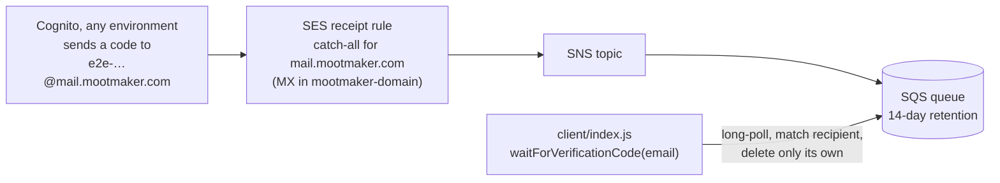

# mootmaker-email-testing

The shared pipeline that lets tests read a **real** Cognito verification email, and the small JavaScript
client tests use to do it. It is deployed once, not per environment, and serves every environment and
every frontend's tests.



Most tests never need this: they create accounts through the API or Cognito's admin calls. It is for
the tests whose subject *is* the email: sign-up with a real code, password reset, and the release smoke
test on `test`. How that fits the test layers is in the hub's
[testing overview](https://github.com/geoffweatherall/mootmaker/blob/main/docs/overview/testing.md).

## Why one shared pipeline

- **SES allows one active receipt rule set per account and region**, so a rule set per environment or per
  run would fight over which is active.
- **Tests separate their mail by address instead.** Each test signs up with a fresh
  `e2e-<uuid>@mail.mootmaker.com` address, and the client only ever takes, and deletes, messages
  addressed to it. Everything else is left for whoever is waiting on it, because a standard SQS queue has
  no ordering to rely on.
- **Messages more than an hour old are deleted as they are met**, since every wait gives up within a
  minute. That keeps the queue near-empty without a separate job.

The domain identity and the `mail.mootmaker.com` MX record belong to
[mootmaker-domain](https://github.com/geoffweatherall/mootmaker-domain). This repository owns the receipt
rule set, the SNS topic and the SQS queue (`deploy/terraform/`).

## Deploying

```bash
./deploy-email-infra.sh      # no environment argument: there is one deployment
./undeploy-email-infra.sh    # breaks real-email tests everywhere at once
```

The queue URL is published to SSM Parameter Store as `/mootmaker/email-testing/sqs-queue-url`. Test
runners read it from there and pass it to the client as `SQS_QUEUE_URL`.

**The Terraform state key (`mootmaker-e2e-email/terraform.tfstate`) and the resource names predate this
repository's name. Never change them as a side effect of anything else.** A new key would point Terraform
at empty state for live resources, and new names would destroy and recreate a pipeline other tests
depend on.

## Using it from tests

`client/index.js` exports three functions:

| Function | Returns |
|---|---|
| `uniqueTestEmail()` | A never-used address under `mail.mootmaker.com` |
| `freshTestAccount()` | `{ name, email, password }`, all unique. The name must be unique too: the API refuses a sign-up whose name matches an existing person |
| `waitForVerificationCode(email, timeoutMs = 60000)` | The six-digit code from the first message addressed to `email`, which it then deletes |

Consumers depend on it from GitHub, pinned to a tag:

```json
"dependencies": {
  "mootmaker-email-testing": "github:geoffweatherall/mootmaker-email-testing#v1.0.0"
}
```

```ts
import { freshTestAccount, waitForVerificationCode } from 'mootmaker-email-testing'
```

Consumers today: mootmaker-webapp's acceptance suite, mootmaker-release's smoke suites, and
mootmaker-android's `email-helper/`, which serves codes to the emulator and to Maestro. Callers need AWS
credentials that can read and delete messages on the queue.

**Changing the client:**
1. Edit `client/index.js` and keep `client/index.d.ts` in step.
2. Run `npm install && npm run typecheck`.
3. Bump `version` in `package.json` and merge.
4. Tag `main` as `v<version>` and push the tag.
5. Raise the `#v…` pin in each consumer.

A tag, not a branch, so a consumer's lockfile and its CI agree on exactly which code runs.

It is plain JavaScript with JSDoc types and a hand-written `.d.ts`, because it is installed into
`node_modules`, where neither Playwright nor Node compiles TypeScript.

How changes here are tested: [testing-strategy.md](testing-strategy.md). If verification emails stop
arriving, see the hub's
[verification email runbook](https://github.com/geoffweatherall/mootmaker/blob/main/docs/runbooks/verification-email-not-arriving.md).
